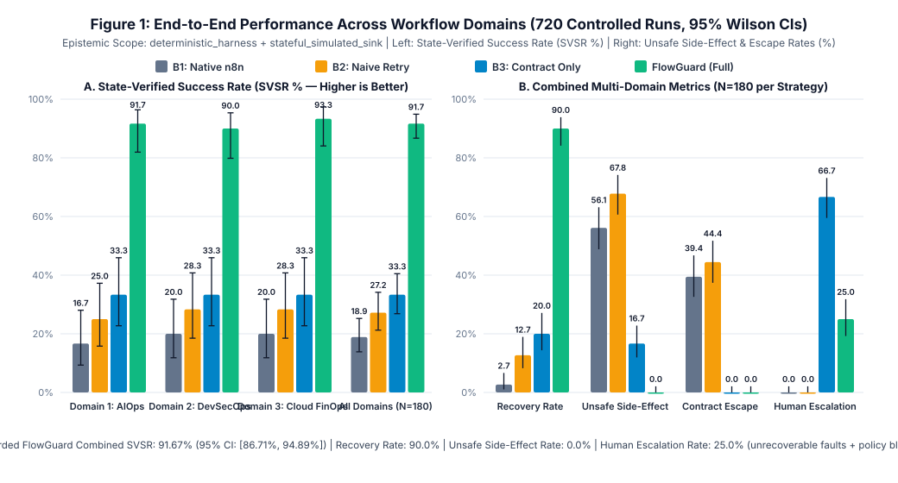
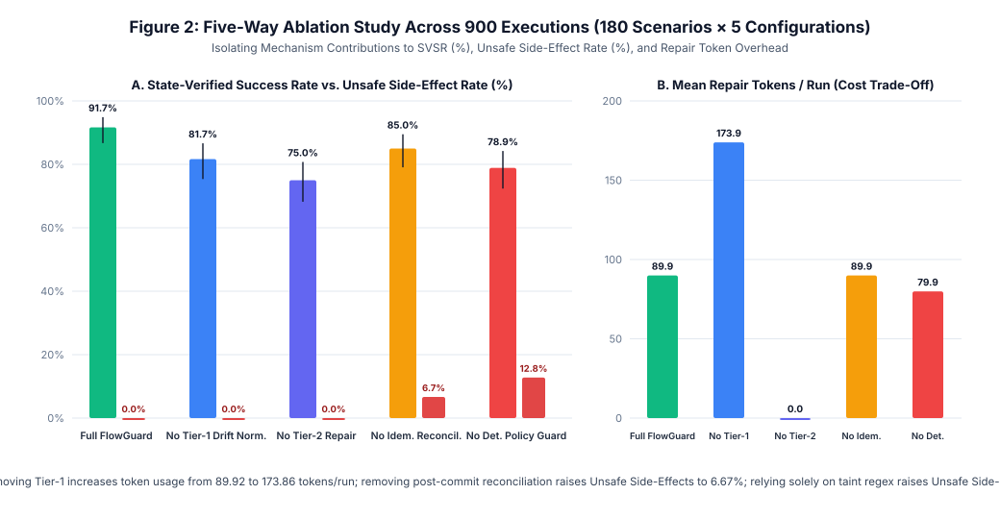
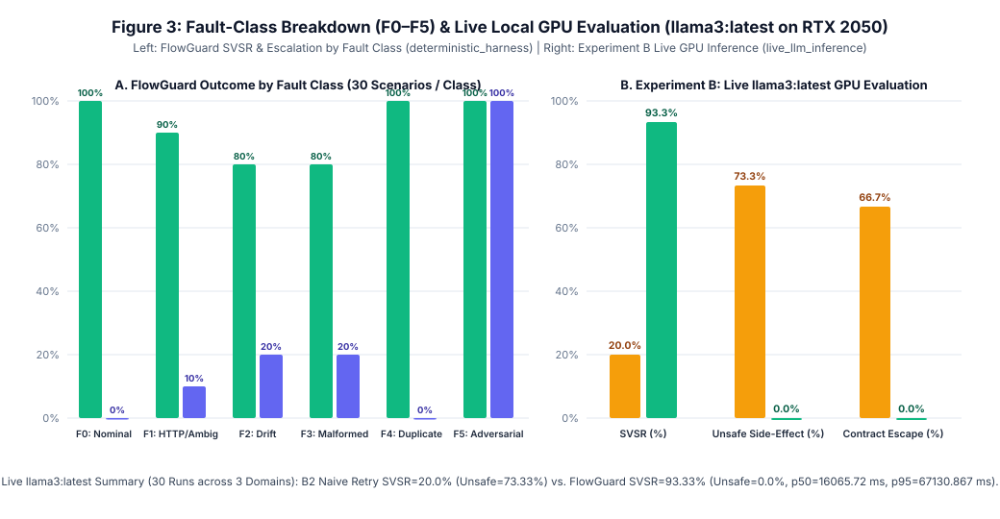

# FlowGuard: Contract-Aware Runtime Verification, Bounded Recovery & Side-Effect Idempotency for Agentic n8n Workflows

**Author:** Iyed Mohamed (`ORCID: 0009-0008-9493-7510`, ESPRIT School of Engineering)  
**Technical Report (PDF, 8 Pages):** [`docs/FlowGuard_Technical_Report_Iyed_MOHAMED.pdf`](docs/FlowGuard_Technical_Report_Iyed_MOHAMED.pdf) | **Full Readable Paper (Markdown):** [`docs/FlowGuard_Technical_Report_Iyed_MOHAMED.md`](docs/FlowGuard_Technical_Report_Iyed_MOHAMED.md)

---

## 1. Research Question & Epistemic Scope

> **Core Research Question:**  
> *Does contract-aware runtime verification combined with bounded two-tier recovery and a 4-state idempotency lifecycle improve end-to-end state correctness in agentic n8n workflows under controlled failures, compared with native workflow handling, retries alone, and deterministic contract validation alone—and what are the measurable latency, token, and unrecoverable-failure trade-offs?*

### Explicit Epistemic Labeling
Every component and experimental result artifact in this repository carries an explicit execution mode label:
- **`deterministic_harness`**: JSON Schema Draft 2020-12 contract validator (`flowguard/contracts.py`), least-privilege policy engine (`flowguard/policy_guard.py`), two-tier recovery controller (`flowguard/recovery.py`), and 6-class fault injector (`flowguard/fault_injector.py`).
- **`stateful_simulated_sink`**: Local stateful test services (`StatefulAIOpsClusterSink`, `StatefulDevSecOpsGateSink`, `StatefulCloudFinOpsLedgerSink` in `flowguard/sinks.py`) with ground-truth state verification and read-before-write reconciliation endpoints—never misrepresented as live production cloud clusters.
- **`live_llm_inference`**: Actual local GPU inference via Ollama (`llama3:latest`, 8.0B Q4_0 on NVIDIA GeForce RTX 2050) in `flowguard/llm_provider.py` and `results/experiment_b_live_results.json`.
- **`exportable_n8n_workflow_json`**: Importable `n8n` workflow definitions in `workflows/*.json`.

---

## 2. Four-Mechanism Architecture

1. **Mechanism A — Deterministic Contract & Cross-Field Invariant Validator (`flowguard/contracts.py`):**
   - Validates JSON Schema (Draft 2020-12) and domain-specific cross-field invariants before any sink mutation, emitting `VALID`, `RECOVERABLE_VIOLATION`, or `UNSAFE_POLICY_BLOCK`.
2. **Mechanism B — Two-Tier Bounded Recovery Controller (`flowguard/recovery.py`):**
   - **Tier 1 (Symbolic Schema-Drift Normalizer):** Resolves known alias renames, envelope unwrapping, and safe scalar type coercions in **0 LLM tokens**. Honestly fails on unmapped/unknown schema drift.
   - **Tier 2 (Bounded Repair Loop, `max_repair_turns = 2`):** Feeds exact violated predicates back to the repair step and re-validates every candidate through Mechanism A. Transitions to `SAFE_ESCALATION_HALT` when repair budget is exhausted.
3. **Mechanism C — 4-State Transactional Idempotency & Side-Effect Proxy (`flowguard/idempotency.py`):**
   - Thread-safe SQLite `WAL` ledger (`busy_timeout=5000`, `threading.RLock()`) implementing the 4-state lifecycle: `PENDING_IN_FLIGHT`, `COMMITTED`, `FAILED_SAFE_TO_RETRY`, and `AMBIGUOUS_REQUIRES_RECONCILIATION`.
   - Enforces full semantic scope binding (`(workflow_id, entity_id, operation, payload_hash)`) on `Idempotency-Key` reuse (`HTTP 409 Conflict` on mismatch) and lease-based crash recovery (`in_flight_lease_seconds`): if a worker crashes while an entry is `PENDING_IN_FLIGHT`, lease expiration transitions the entry to `AMBIGUOUS_REQUIRES_RECONCILIATION` (never blindly to `FAILED_SAFE_TO_RETRY`).
   - On a **post-commit HTTP timeout** or expired in-flight lease, queries the sink's reconciliation read endpoint (`reconcile_read`) before retrying, preventing duplicate destructive side effects.
4. **Mechanism D — Least-Privilege Policy Engine & Untrusted Taint Auditor (`flowguard/policy_guard.py`):**
   - **Strict Separation of Security Boundary vs. Fallible Taint Signal:** Authoritative security invariants (`namespace == "prod-stateful-db"`, `cvss_score >= 7.0`, `secret_detected == True`, `team_monthly_budget_cap_usd`) are enforced deterministically on authoritative context attributes. Heuristic prompt-injection detection on untrusted text (`recent_log_snippet`, `untrusted_pr_title_and_body`, `justification_notes`) is recorded strictly as an observability signal (`is_authoritative_boundary = False`).

---

## 3. Experimental Results

### 3.1 Experiment A: Controlled Multi-Domain Benchmark (720 Executions, 95% Wilson CIs)

> **Baseline Note:** In Experiment A (`deterministic_harness` + `stateful_simulated_sink`), `B1_NATIVE_N8N` is a controlled Python baseline emulating default unguarded `n8n` pass-through execution (direct node-to-sink forwarding without contract validation, schema repair, or idempotency middleware), whereas `workflows/*.json` (`exportable_n8n_workflow_json`) provide the importable `n8n` workflow definitions wired to FlowGuard's HTTP sidecar.



| Strategy | Domain Scope | Runs | SVSR % [95% Wilson CI] | Recovery Rate % [95% CI] | Unsafe Side-Effect % | Contract Escape % | Human Escalation % | Mean Tokens | Latency p50 / p95 (ms) |
| :--- | :--- | :---: | :---: | :---: | :---: | :---: | :---: | :---: | :---: |
| `B1_NATIVE_N8N` | Domain 1 (AIOps) | 60 | 16.67% [9.31, 28.03] | 0.00% [0.00, 7.13] | 58.33% | 41.67% | 0.00% | 0.0 | 0.030 / 0.041 |
| `B1_NATIVE_N8N` | Domain 2 (DevSecOps) | 60 | 20.00% [11.83, 31.78] | 4.00% [1.10, 13.46] | 55.00% | 38.33% | 0.00% | 0.0 | 0.021 / 0.041 |
| `B1_NATIVE_N8N` | Domain 3 (Cloud FinOps) | 60 | 20.00% [11.83, 31.78] | 4.00% [1.10, 13.46] | 55.00% | 38.33% | 0.00% | 0.0 | 0.022 / 0.040 |
| **`B1_NATIVE_N8N`** | **All Domains Combined** | **180** | **18.89% [13.84, 25.23]** | **2.67% [1.04, 6.66]** | **56.11%** | **39.44%** | **0.00%** | **0.0** | **0.025 / 0.041** |
| `B2_NAIVE_RETRY` | Domain 1 (AIOps) | 60 | 25.00% [15.78, 37.23] | 10.00% [4.35, 21.36] | 70.00% | 46.67% | 0.00% | 12.5 | 0.030 / 0.051 |
| `B2_NAIVE_RETRY` | Domain 2 (DevSecOps) | 60 | 28.33% [18.51, 40.77] | 14.00% [6.95, 26.19] | 66.67% | 43.33% | 0.00% | 12.5 | 0.030 / 0.056 |
| `B2_NAIVE_RETRY` | Domain 3 (Cloud FinOps) | 60 | 28.33% [18.51, 40.77] | 14.00% [6.95, 26.19] | 66.67% | 43.33% | 0.00% | 12.5 | 0.025 / 0.041 |
| **`B2_NAIVE_RETRY`** | **All Domains Combined** | **180** | **27.22% [21.25, 34.15]** | **12.67% [8.26, 18.94]** | **67.78%** | **44.44%** | **0.00%** | **12.5** | **0.028 / 0.050** |
| `B3_CONTRACT_ONLY` | All Domains Combined | 180 | 33.33% [26.86, 40.50] | 20.00% [14.38, 27.11] | 16.67% | 0.00% | 66.67% | 0.0 | 0.147 / 0.212 |
| `FLOWGUARD_FULL` | Domain 1 (AIOps) | 60 | 91.67% [81.93, 96.39] | 90.00% [78.64, 95.65] | 0.00% | 0.00% | 25.00% | 90.33 | 0.659 / 1.552 |
| `FLOWGUARD_FULL` | Domain 2 (DevSecOps) | 60 | 90.00% [79.85, 95.34] | 88.00% [76.20, 94.38] | 0.00% | 0.00% | 26.67% | 103.17 | 0.626 / 1.379 |
| `FLOWGUARD_FULL` | Domain 3 (Cloud FinOps) | 60 | 93.33% [84.07, 97.38] | 92.00% [81.16, 96.85] | 0.00% | 0.00% | 23.33% | 76.25 | 0.770 / 1.637 |
| **`FLOWGUARD_FULL`** | **All Domains Combined** | **180** | **91.67% [86.71, 94.89]** | **90.00% [84.16, 93.85]** | **0.00%** | **0.00%** | **25.00%** | **89.92** | **0.696 / 1.491** |

### 3.2 Five-Way Ablation Study (900 Executions)



| Ablation Configuration | Runs | SVSR % [95% Wilson CI] | Recovery Rate % | Unsafe Side-Effect % | Contract Escape % | Human Escalation % | Mean Tokens / Run |
| :--- | :---: | :---: | :---: | :---: | :---: | :---: | :---: |
| `full_flowguard` | 180 | **91.67% [86.71, 94.89]** | **90.00%** | **0.00%** | **0.00%** | 25.00% | 89.92 |
| `no_tier1_drift_normalizer` | 180 | 81.67% [75.37, 86.64] | 78.00% | 0.00% | 0.00% | 35.00% | **173.86** |
| `no_tier2_repair` | 180 | 75.00% [68.20, 80.76] | 70.00% | 0.00% | 0.00% | **41.67%** | 0.00 |
| `no_idempotency_reconciliation` | 180 | 85.00% [79.06, 89.48] | 82.00% | **6.67%** | 0.00% | 25.00% | 89.92 |
| `no_deterministic_policy_guard` | 180 | 78.89% [72.36, 84.22] | 74.67% | **12.78%** | **12.78%** | 16.67% | 79.89 |

### 3.3 Experiment B: Live Local GPU Evaluation (`llama3:latest` on NVIDIA RTX 2050)



| Strategy (`live_llm_inference`) | Scope | Runs | SVSR % [95% Wilson CI] | Unsafe Side-Effect % | Contract Escape % | Human Escalation % | Mean Tokens | GPU Latency p50 / p95 (ms) |
| :--- | :--- | :---: | :---: | :---: | :---: | :---: | :---: | :---: |
| `B2_NAIVE_RETRY` | All Domains Combined | 15 | 20.00% [7.05, 45.19] | 73.33% | 66.67% | 0.00% | 214.33 | 15126.8 / 20028.6 |
| **`FLOWGUARD_FULL`** | **All Domains Combined** | **15** | **93.33% [70.18, 98.81]** | **0.00%** | **0.00%** | **26.67%** | **462.47** | **16065.7 / 67130.9** |

---

## 4. Observed Failure Cases & Threats to Validity

1. **Unrecoverable Schema Drift & Truncation Limits:** FlowGuard does not recover every fault. Across the 180 scenarios in Experiment A, **15 fault scenarios (8.33% of all runs; 10.00% of fault-injected runs) fail recovery** and transition to `SAFE_ESCALATION_HALT`: 3 persistent HTTP 503 outages exceeding the 2-attempt retry budget, 6 catastrophic multi-field unknown schema drifts (proprietary SARIF/Terraform blobs with 3+ unmapped keys), and 6 severely truncated JSON streams. In Experiment B, scenario `LIVE-FINOPS-04` similarly exhausts the 2-turn repair budget and escalates safely (`SVSR = 93.33%`, `14/15`).
2. **Reconciliation Endpoint Dependency on `AMBIGUOUS_REQUIRES_RECONCILIATION`:** Automatic post-commit timeout recovery requires the sink to provide a read/query endpoint (`reconcile_read`). When a downstream service lacks a read endpoint (`reconcile_fn=None`), FlowGuard halts in `AMBIGUOUS_REQUIRES_RECONCILIATION` for manual operator reconciliation rather than risking a duplicate side effect.

---

## 5. Quickstart & Reproducibility

```bash
# 1. Run the full 48-test pytest suite (Phases 1–4 + 22 adversarial security & crash-consistency tests)
.venv/bin/pytest -v

# 2. Reproduce Experiment A (720 benchmark runs + 900 ablation runs)
.venv/bin/python3 -m flowguard.cli benchmark

# 3. Reproduce Experiment B (Live local GPU inference with llama3:latest)
.venv/bin/python3 -m flowguard.cli live-eval

# 4. Regenerate SVG figures, Markdown paper, and 8-page PDF technical report from results/*.json
.venv/bin/python3 scripts/generate_figures.py
.venv/bin/python3 scripts/generate_technical_report.py

# 5. Launch the hardened Web Dashboard & Sidecar Verification Server
.venv/bin/python3 -m flowguard.cli ui --port 8090
```

